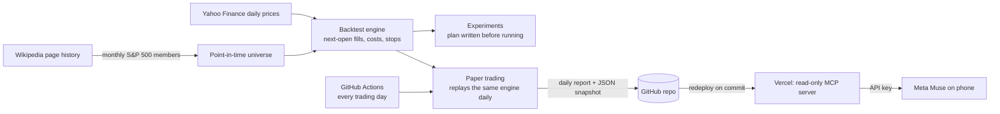

# StockPilot


A rule-based US stock trading research system: a backtest engine built to avoid look-ahead and survivorship bias, a set of pre-registered experiments, and a paper-trading agent that runs daily in the cloud and can be queried from a phone through Meta Muse.

**Status: research concluded.** None of the strategies tested beat simply holding the S&P 500 in a robust, risk-controlled way once the data was cleaned of hindsight. The system keeps running as a live paper-trading demo with simulated money.

## Key findings

| Finding | Evidence |
|---|---|
| **A hand-picked stock list inflated returns by about 4.5% a year.** | The same breakout rules earned 12.1% a year on 37 stocks chosen in 2026, but 7.6% on a point-in-time S&P 500 universe rebuilt from Wikipedia page history. |
| **The breakout strategy loses to the simplest version of its own idea.** | Holding SPY only while it is above its 200-day moving average earned 8.6% a year with a −19.9% worst drawdown, against breakout's 7.6% and −25.9%, using one-seventh of the trades. ([002](experiments/002_spy_trend_benchmark.md)) |
| **Buy-and-hold had the highest return.** | SPY buy-and-hold: 13.2% a year, −33.7% worst drawdown, over 2015-01 to 2026-11. |
| **A trailing stop made things worse.** | ATR trailing stops were tighter than the existing exit; every variant held winners for less time, paid more fees and earned less. ([001](experiments/001_trailing_stop.md)) |
| **Monthly momentum passed on paper but was not accepted.** | It beat both benchmarks from 2022 (18.5% a year) but lost to them in 2015–2021, fell 50% from a 2026 peak, and had a lower Sharpe ratio than buy-and-hold. ([003](experiments/003_monthly_momentum.md)) |

All figures: $3,000 starting cash, after commissions and slippage.

## How it works



- **One code path.** Backtests and paper trading drive the same `Simulator`, one session at a time. A test steps the paper ledger in chunks, saving and reloading it in between, and checks the result equals one continuous backtest.
- **Append-only paper ledger.** Each run restores the saved account state and steps only the sessions that are new; each session gets an immutable record in `paper/ledger/days/`. Later data revisions cannot rewrite history, and a second run on the same day changes no file (verified by file hashes).
- **Checked data, explicit status.** A run first finds the latest completed NYSE session (holidays and early closes included), then requires SPY to reach it, every held or ordered stock to have a price, every eligible candidate to have a price, and 95% of the month's index members to be priced. The report and Muse show: `DATA ERROR` (nothing new published), `ORDERS QUEUED` (with the session they are valid for, rank, sizing reason and planned stop), `ORDERS EXPIRED` (the intended open has passed), or `NO SIGNAL` (with how many stocks met each rule and which were closest).
- **Read-only connector.** The MCP server on Vercel can only read the latest snapshot. It has no tool that places orders or changes anything, and it rejects requests without the API key.

## Methodology

**No look-ahead.** Signals use data up to the close of day *t*; orders fill at the open of day *t+1*. Share counts are fixed from the close of *t*, because the next open is unknown when the order is placed. Tests rewrite all prices after a cut-off date and check that every result before it is unchanged, for the breakout engine, the trailing stop, the momentum rotation and the market-timing benchmark.

**Point-in-time universe.** For each month, S&P 500 membership is taken from the Wikipedia revision that was live on the first of the month (155 snapshots, 792 distinct stocks). Renamed tickers are joined through SEC CIK numbers (e.g. FB → META, BBT → TFC). The `sp500` universe uses the 50 members with the highest 60-day dollar volume, ranked on data from before the month starts.

**Realistic costs.** IBKR Pro fixed commissions ($0.005 per share, $1 minimum, capped at 1% of trade value) plus 5 bps slippage per side. Stops that gap through fill at the open, not at the stop price.

**Pre-registered experiments.** Each experiment's variants, selection rule and acceptance criteria are written and committed before any code runs ([template](experiments/TEMPLATE.md)). Variants are compared on 2015–2021 only; the single pick is tested once on 2022 onward. Failed and inconvenient results are recorded as they came out, and corrections after external review are marked as such.

## Results by universe (breakout_v1)

| Universe | How stocks are chosen | CAGR | Max drawdown | Trades | Fees |
|---|---|---|---|---|---|
| `curated` | 37 large caps and ETFs picked by hand in 2026 (hindsight) | 12.1% | −24.5% | 384 | $791 |
| `sp500` | Monthly top 50 by dollar volume among that month's S&P 500 members | 7.6% | −25.9% | 423 | $849 |
| `etf` | 11 SPDR sector ETFs plus QQQ, IWM, DIA | 1.2% | −27.6% | 396 | $792 |
| SPY buy-and-hold | | 13.2% | −33.7% | 1 | $1 |

- On `sp500`, five trades (MU, NVDA, SNDK, PLTR, CVX) produced 89% of gross profit, so the result depends heavily on catching a few big winners.
- On `etf`, the average winning trade made 7% and the $1 minimum commission took 64% of gross profit.
- An earlier trend-pullback strategy was dropped: 16.0% a year in 2015–2021 but −8.9% from 2022. Its entries sat too close to its own exit line, so small moves shook positions out.

## Strategy: breakout_v1

| | Rule |
|---|---|
| Market filter | Open new positions only when SPY closes above its 200-day MA |
| Entry | Close above the 50-day MA and a new 20-day closing high |
| Exit | Close below the 50-day MA, or the stop-loss |
| Stop-loss | Entry price − 2 × ATR(14) |
| Sizing | Risk 2% of equity to the stop; at most 20% of equity per stock; at most 5 positions |
| Ranking | 60-day momentum when there are more candidates than free slots |

Notes from an external review: the 2% risk is a target, not a cap. An overnight gap below the stop fills at the open, so 12 of 289 losing trades on `sp500` lost more than 2% of equity (worst: 4.96%). The market filter only blocks new buys; it does not sell existing positions. There is no sector limit.

## Repository layout

```
stockpilot/
  backtest/engine.py     portfolio backtest: next-open fills, stops, costs, paper mode
  backtest/timing.py     single-asset moving-average timing (benchmark)
  backtest/rotation.py   monthly momentum rotation
  backtest/metrics.py    CAGR, drawdown, Sharpe, trade statistics
  strategy/              breakout_v1 and indicators
  data/market.py         Yahoo download, cleaning, cache
  data/sp500.py          point-in-time S&P 500 membership from Wikipedia history
  universe.py            monthly top-N eligibility
scripts/
  backtest.py            backtest by universe and period
  paper.py               daily paper-trading run
  build_sp500_history.py rebuild the membership file
experiments/             plans, runners and results for each experiment
muse/                    read-only MCP server for Vercel
  ledger.py              append-only paper ledger: restore, data checks, step new sessions
  marketcal.py           NYSE sessions, holidays, early closes
paper/                   paper account: config, ledger, daily reports, order log
tests/                   40 tests, including look-ahead and ledger-replay checks
```

## Quick start

```bash
python -m venv .venv
source .venv/bin/activate          # Windows: .venv\Scripts\activate
pip install -e ".[dev]"

pytest                                         # all tests should pass
python scripts/backtest.py --universe sp500    # downloads ~800 stocks the first time
python scripts/paper.py                        # one paper-trading day
python experiments/run_002_spy_trend.py        # reproduce an experiment
```

## Cloud setup

- `.github/workflows/daily.yml` runs `scripts/paper.py` early each weekday morning (New York time, before the open) and commits the ledger, the report, the order log, the Muse snapshot and any new membership snapshot. Prices for paper trading are adjusted for splits only, so recorded fills stay comparable from day to day; dividends are not credited.
- `.github/workflows/tests.yml` runs the test suite on every code change.
- `muse/` deploys to Vercel with `muse` as the root directory. Set `MUSE_API_KEY` (at least 20 characters) as an environment variable; the server rejects everything if it is missing. Every commit triggers a redeploy, so Muse reads the latest snapshot.

## Known limitations

- **Delisted stocks are missing.** 10.1% of S&P 500 member-months have no price inside that month, mostly companies that were later delisted or acquired. Results on `sp500` are therefore somewhat optimistic. (An earlier version said 8.2%; it counted a stock as covered if it had prices for any period, not for the month in question.)
- **2022 onward has been looked at.** Experiments 002 and 003 used it, so any idea developed from here can only be validated on new data, through paper trading.
- **Free data.** yfinance is unofficial and Wikipedia's membership history can lag real index changes by days.
- **No interest on cash** in any backtest, which understates strategies that spend time out of the market.
- **No earnings, news or sector limits** in the strategy.

## If this were continued

Only ideas that clear the acceptance template, which requires beating both buy-and-hold and the 200-day-MA benchmark on return, Sharpe ratio and drawdown, would be worth paper trading. Candidates that remain untested: isolating which part of breakout_v1 hurts it (one change at a time), an LLM news-risk filter run as a paper-trading A/B test, and model-based scoring of breakout signals with walk-forward validation.
